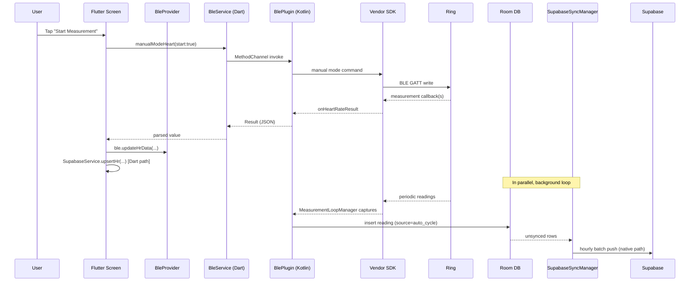
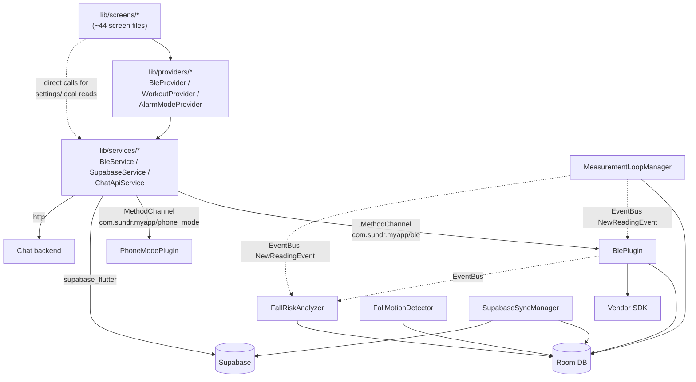
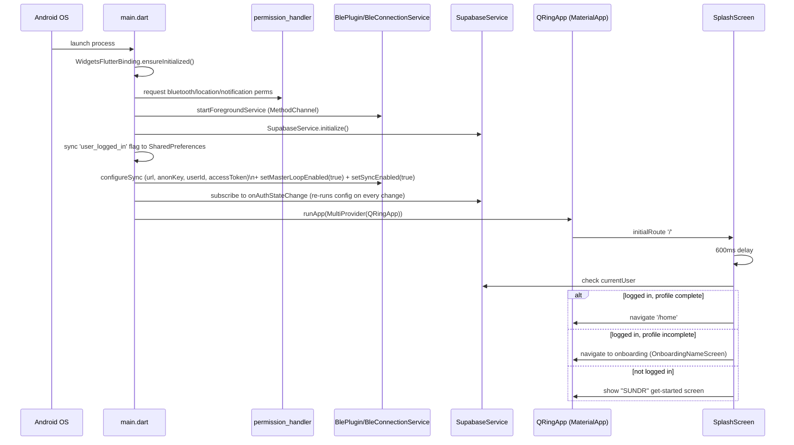
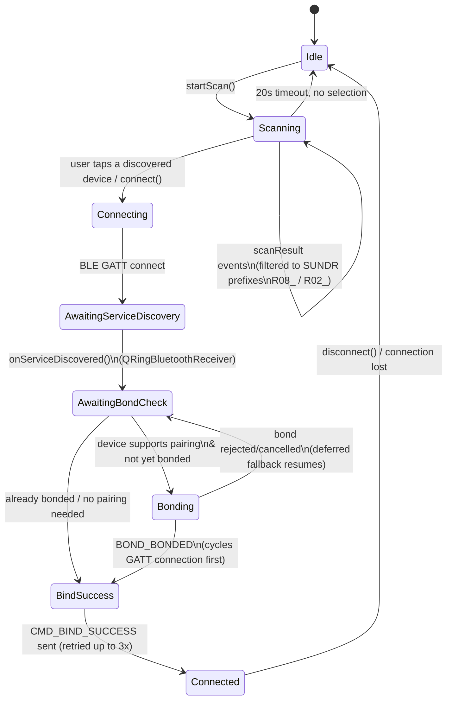
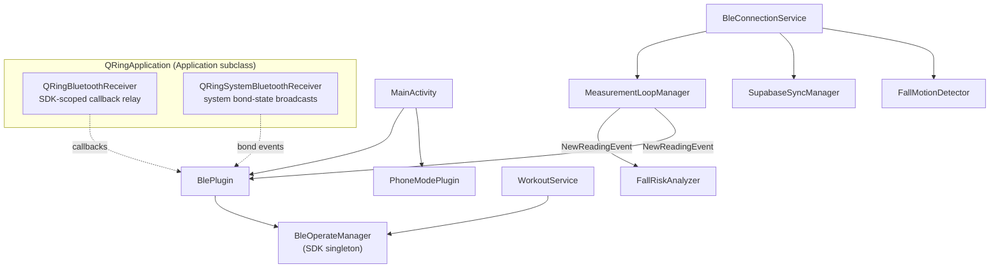
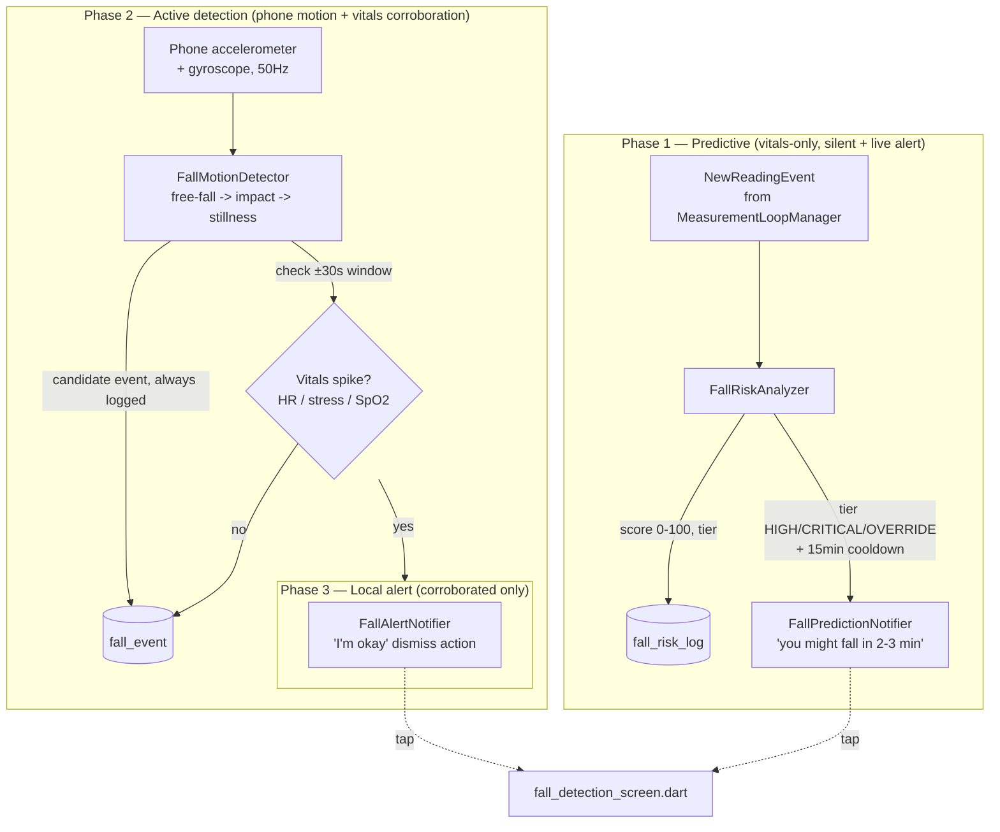

# SUNDR — Knowledge Transfer Document

| | |
|---|---|
| **Project** | SUNDR — smart-ring health companion app (Flutter package `sundr`, Android namespace `com.sundr.myapp`) |
| **Repo root** | `C:\Users\sugee\Documents\GitHub\Vital2026\The_Vital_Monitoring` |
| **Platform** | Flutter (Android primary target; iOS/desktop scaffolding present but not the active target) |
| **Backend** | Supabase (Postgres + Auth), plus a separate self-hosted chat API |
| **Hardware** | A BLE smart ring, driven via a closed-source Android SDK (`qring_sdk_1.0.0.50.aar`, package `com.oudmon.ble.*`) |
| **Document date** | 2026-07-12 |
| **Audience** | A new engineer taking over this codebase with no prior context |

> **Naming note:** the app is user-facing branded **"SUNDR"**. The Flutter package (`sundr`), Android namespace
> (`com.sundr.myapp`), Kotlin package (`com.sundr.myapp`), and all Method/EventChannel names
> (`com.sundr.myapp/*`) are unified. A few **legacy identifiers intentionally keep the `qring_` prefix** for
> data compatibility across installs: the Room database name (`qring_local.db`), SharedPreferences keys
> (`qring_supabase_*`, `qring_fall_*`, …), notification channel IDs (`qring_ble_connection`, …), and the
> vendor SDK artifact (`qring_sdk_*.aar`). Some internal Kotlin class names still say **QRing**
> (`QRingApplication`, `QRingDatabase`, `QRingBluetoothReceiver`, …) — same app, cosmetic-only.

---

## Table of Contents

1. [Executive Summary](#1-executive-summary)
2. [High-Level Architecture](#2-high-level-architecture)
3. [Project Structure](#3-project-structure)
4. [Application Flow](#4-application-flow)
5. [Screen-by-Screen Documentation](#5-screen-by-screen-documentation)
6. [SDK and Device Integration](#6-sdk-and-device-integration)
7. [Data Management](#7-data-management)
8. [Key Features](#8-key-features)
9. [Development Workflow](#9-development-workflow)
10. [Important Classes and Services](#10-important-classes-and-services)
11. [Integration Points](#11-integration-points)
12. [Known Issues and Technical Debt](#12-known-issues-and-technical-debt)
13. [Recommended Next Steps](#13-recommended-next-steps)
14. [Developer Onboarding Guide](#14-developer-onboarding-guide)

---

## 1. Executive Summary

### What this project is

SUMTHING is a **Flutter companion app for a Bluetooth-LE smart ring**. It replicates and extends the feature set of the ring vendor's own Kotlin reference app ("SDKSample"), wrapping the vendor's proprietary Android SDK behind a clean Flutter UI. The app:

- Pairs with and manages a physical smart ring over BLE.
- Continuously collects vitals in the background (heart rate, SpO2, blood pressure, stress, HRV, steps) via a native Android foreground service, independent of whether the Flutter engine/UI is running.
- Displays those vitals with a premium, dark-glassmorphism dashboard (see `DESIGN.md`).
- Syncs data to a Supabase Postgres backend for durable, cross-device history, along with a full authentication system.
- Adds value-add features on top of the raw SDK: workout tracking, women's health/cycle tracking, phone "Focus/Prayer/Base" modes (DND automation), sleep/hydration reminders, OTA firmware updates, an AI chat assistant, and — the newest and most bespoke feature — **predictive/active fall detection**.

### Business purpose

The product targets a "luxury healthcare" positioning (explicitly modeled after Oura/Whoop/Apple Health per `DESIGN.md`), differentiating on **fall risk prediction for at-risk populations** (elderly/cardiovascular-risk users) as its flagship differentiator, layered on top of standard smart-ring vitals tracking.

### Key features

- Real-time + historical vitals dashboards: Heart Rate, Blood Pressure, SpO2, HRV, Stress, Sleep, Temperature, Steps.
- Device pairing, connection management, OTA firmware updates.
- Workout tracking (12 categories, 150+ specific sports) with live in-workout metrics.
- Women's health / menstrual cycle tracking with phase prediction.
- Phone mode automation (Focus / Prayer / Base) that drives system Do-Not-Disturb.
- Sleep and hydration/sedentary reminders.
- AI chat assistant ("Assist") backed by a separate REST chat backend.
- **Fall risk prediction** (vitals-based, silent scoring) + **active fall detection** (phone-accelerometer-based, vitals-corroborated) + local alerting + emergency-contact management.
- Full Supabase-backed auth (sign up / log in) and onboarding.

### Current development status

Pre-release / active development. There is no versioned release process yet (Room DB uses destructive migrations, meaning the local database schema is not considered stable). Core vitals tracking, pairing, and dashboards are functional and exercised. Fall detection is the most recently built and most actively evolving feature (see `FALL_DETECTION_STATUS.md`).

### Major completed work

- Full BLE bridge (Flutter ↔ Kotlin ↔ vendor SDK) covering ~90 native methods across all vital types, settings, OTA, and workouts.
- Native background measurement loop (`MeasurementLoopManager`) with a local Room database as the on-device source of truth.
- Dual Supabase sync paths (Dart-side for interactive reads/writes, native Kotlin-side for background push independent of the Flutter engine).
- Fall detection: Phase 1 (vitals risk scoring), Phase 2 (phone-motion detection + vitals corroboration), Phase 3 (local alerting) — all live, including a **predictive** alert path that was deliberately taken live ahead of the original validate-before-alerting plan (see [§12](#12-known-issues-and-technical-debt)).
- Full onboarding, auth, and profile flows.
- Workout tracking with a dedicated foreground service.
- Phone Focus/Prayer/Base mode automation with native DND control.

### Known limitations or unfinished areas

- Several screens are **UI stubs not yet wired to persistence** (`select_notifications_screen.dart`, parts of `settings_screen.dart`, `sugar_lipids_screen.dart`, `sport_record_screen.dart`, `records_screen.dart`).
- Fall detection: no caregiver push notification yet, no auto-dial to emergency contacts, no battery-impact measurement done, and — most importantly — **the risk-prediction alert is live in production without having been validated against real fall/near-fall data** (a deliberate, client-approved risk — see [§12](#12-known-issues-and-technical-debt)).
- `MeasurementLoopManager`'s cycle cooldown is hardcoded to a testing value (20s instead of an intended 60s) — flagged directly in code comments as not yet reverted for production.
- Supabase credentials are hardcoded in Dart source (mitigated by RLS, but no secrets-management indirection).
- No automated test suite beyond the default Flutter counter-app placeholder test.
- Duplicated business logic (activity score formula, status-classification thresholds) is copy-pasted across Home and several detail screens instead of centralized.

---

## 2. High-Level Architecture

### 2.1 System overview

```mermaid
flowchart TB
    subgraph Ring["Smart Ring (BLE Peripheral)"]
        RingHW[Ring Firmware]
    end

    subgraph Phone["Android Phone"]
        subgraph FlutterEngine["Flutter Engine (Dart)"]
            UI[Screens / Widgets]
            Providers["Providers\n(BleProvider, WorkoutProvider,\nAlarmModeProvider)"]
            Services["Services\n(BleService, SupabaseService,\nChatApiService)"]
        end

        subgraph NativeAndroid["Native Android (Kotlin)"]
            BlePlugin[BlePlugin.kt\nMethodChannel + EventChannel]
            BleConnService["BleConnectionService\n(foreground service)"]
            WorkoutSvc["WorkoutService\n(foreground service)"]
            MeasureLoop[MeasurementLoopManager]
            FallStack["Fall Detection Stack\n(FallRiskAnalyzer, FallMotionDetector,\nFallAlertNotifier)"]
            SyncMgr[SupabaseSyncManager]
            RoomDB[("Room DB\nqring_local.db")]
            SDK["Vendor SDK\nqring_sdk_1.0.0.50.aar\n(com.oudmon.ble.*)"]
        end
    end

    subgraph Cloud["Cloud Services"]
        Supabase[("Supabase\nPostgres + Auth")]
        ChatAPI["Self-hosted Chat API\n(REST, separate backend)"]
    end

    RingHW <-->|BLE GATT| SDK
    SDK <--> BlePlugin
    BlePlugin <-->|MethodChannel /\nEventChannel| Services
    Services <--> Providers
    Providers <--> UI

    BleConnService --> MeasureLoop
    BleConnService --> SyncMgr
    BleConnService --> FallStack
    MeasureLoop --> RoomDB
    MeasureLoop -->|NewReadingEvent\n(EventBus)| FallStack
    MeasureLoop -->|NewReadingEvent| BlePlugin
    FallStack --> RoomDB
    SyncMgr -->|HTTP REST, hourly| Supabase
    Services -->|supabase_flutter SDK| Supabase
    Services -->|HTTP| ChatAPI
    WorkoutSvc --> SDK
    RoomDB --> BlePlugin
```

### 2.2 Frontend architecture

- **Framework**: Flutter, Material 3, single permanent dark theme (`AppTheme.darkTheme()` in `lib/theme/app_theme.dart`) implementing the visual rules in `DESIGN.md` (near-black background, gold accent `#C9A86E`/`#D4A853`, glassmorphism cards, per-vital color coding).
- **State management**: Plain `ChangeNotifier` + the `provider` package. Three app-root providers constructed once in `main.dart` inside a `MultiProvider` and never scoped/nested: `BleProvider` (dominant — owns nearly all "current vitals" and connection state), `WorkoutProvider`, `AlarmModeProvider`. No Riverpod/Bloc/GetX.
- **Navigation**: `MaterialApp` with a named-route table (`lib/app.dart`) for ~29 "main" destinations reachable from Home/Settings, plus direct `Navigator.push(MaterialPageRoute(...))` for flow-based screens (onboarding, auth, chat, active workout, history) that aren't meant to be deep-linked to directly.
- **Local-first UI pattern**: nearly every vitals screen reads "today" data from the **native local Room DB** first (via `BleService`, which is fast and works offline) and only reads Supabase for past days / multi-day trends. This is a deliberate, repeated architectural pattern (see [§4.4](#44-data-synchronization-flow)).

### 2.3 Backend architecture

There is **no custom application backend** in the traditional sense — the "backend" is:
1. **Supabase** (hosted Postgres + Auth) — the durable, cross-device data store and the identity provider. Both the Dart layer and the native Kotlin layer talk to it directly over REST (see [§2.6](#26-two-independent-supabase-sync-paths) and [§7](#7-data-management)).
2. **A separate self-hosted chat API** (`ChatApiService`, `lib/services/chat_api_service.dart`) — a small REST service (`/chat`, `/history/{userId}`, `/history/messages/{conversationId}`) backing the "Assist" AI chat feature. Its base URL is currently a `localhost`/emulator-loopback placeholder (`10.0.2.2` on Android emulator) with a `TODO` to point it at a deployed URL — **this backend's implementation lives outside this repository** and its deployment location needs to be established/confirmed with whoever owns it.

### 2.4 SDK integration architecture

The vendor supplies a closed-source Android AAR (`android/app/libs/qring_sdk_1.0.0.50.aar`, decompiled package `com.oudmon.ble.*`) that talks to the ring over BLE GATT. This SDK is **only accessible from native Android/Kotlin code** — Flutter never touches BLE directly. `BlePlugin.kt` (~3,250 lines) is the single bridge class wrapping the SDK's callback-based API into a request/response `MethodChannel` plus a push-style `EventChannel`. See [§6](#6-sdk-and-device-integration) for full detail.

### 2.5 Database architecture

Two databases exist, serving different purposes:

| | **Local: Room (SQLite)** | **Cloud: Supabase (Postgres)** |
|---|---|---|
| Location | On-device, native Android (`qring_local.db`) | Hosted, shared across devices/reinstalls |
| Written by | `MeasurementLoopManager`, `WorkoutService`, `PhoneModePlugin`, `FallRiskAnalyzer`, `FallMotionDetector` (all native Kotlin) | `SupabaseService` (Dart) **and** `SupabaseSyncManager` (native Kotlin) — two independent writers |
| Purpose | Fast, offline-capable "today" reads; source of truth for continuous background measurement; fall-detection logs; emergency contacts | Durable history, cross-device sync, auth, daily aggregates for trend charts |
| Read by | `BlePlugin` (exposed to Dart via `getReadings`/`getTodaySummary`/etc.) | `SupabaseService` (Dart), for past-day and 7-day-trend views |
| Migration strategy | `fallbackToDestructiveMigration` — **no real migrations exist**, schema changes wipe local data (acceptable pre-release) | SQL migration files under `supabase/migrations/` |

### 2.6 Two independent Supabase sync paths

A pattern worth calling out explicitly because it's easy to miss: **both Dart and native Kotlin talk to Supabase independently**, for different reasons.

```mermaid
flowchart LR
    subgraph Dart["Dart side"]
        UIScreens[Vitals/Settings Screens]
        SupaSvc[SupabaseService]
    end
    subgraph Native["Native Kotlin side"]
        Room[(Room DB)]
        SyncMgr[SupabaseSyncManager]
        Config[SupabaseConfig\nSharedPreferences cache]
    end
    UIScreens -->|interactive reads/writes\ne.g. manual measurement,\nprofile edit, workout save| SupaSvc
    SupaSvc -->|supabase_flutter| PG[(Supabase Postgres)]
    Room --> SyncMgr
    SyncMgr -->|hourly batch push\nOkHttp + PostgREST| PG
    UIScreens -->|configureSync MethodChannel\n(url, anonKey, userId, accessToken)| Config
    Config --> SyncMgr
```

- **Dart path** (`SupabaseService`): handles everything that happens *while the user is actively in the app* — auth, profile edits, manual "Measure Now" inserts, workout-session save, women's-health data. Uses the `supabase_flutter` package directly.
- **Native path** (`SupabaseSyncManager`, inside `BleConnectionService`): pushes the continuously-collected background vitals from Room to Supabase **even when the Flutter/Dart engine isn't running** (app backgrounded/killed, or shortly after device boot). It caches its own copy of the Supabase URL/anon key/user id/access token (`SupabaseConfig`, fed by Dart via the `configureSync` MethodChannel call on every login/token-refresh), and pushes hourly via raw HTTP (OkHttp) to PostgREST, using `on_conflict=user_id,measured_at` upserts.

This split exists because continuous ring-data collection is driven by a native Android foreground service that must survive independent of the Dart isolate's lifecycle.

### 2.7 External services and dependencies

| Service/Dependency | Purpose |
|---|---|
| Supabase (Postgres + Auth) | Primary cloud backend: auth, durable vitals history, profile, workouts, women's health data |
| Self-hosted Chat API (external repo, URL TBD) | AI chat assistant backend |
| Vendor ring SDK (`qring_sdk_1.0.0.50.aar`) | All BLE communication with the physical ring |
| Android system services | Bluetooth stack, Do-Not-Disturb (`NotificationManager.setInterruptionFilter`), notifications, boot receiver, foreground services |
| `permission_handler` | Runtime permission requests (Bluetooth, location, notifications) |
| `file_picker` | OTA firmware `.bin` file selection |
| `url_launcher` | `tel:`/`sms:` intents for emergency contacts |

### 2.8 Data flow: user interaction → storage



---

## 3. Project Structure

```
new-flutter/
├── lib/                        # Flutter/Dart application code
│   ├── main.dart                # App entry point & startup sequence
│   ├── app.dart                 # MaterialApp + named route table
│   ├── models/                  # Plain Dart data classes
│   ├── providers/                # ChangeNotifier state containers
│   ├── services/                 # Native-bridge & HTTP clients
│   ├── theme/                    # AppTheme (design tokens)
│   ├── widgets/                  # Shared reusable UI components
│   └── screens/                  # All UI screens, grouped by feature
│       ├── auth/                 # Splash, login, sign-up
│       ├── onboarding/           # 6-step profile setup + ring pairing
│       ├── home/                 # Main dashboard + scan sheet
│       ├── health/                # Per-vital detail screens (10 screens)
│       ├── settings/              # 13 settings sub-screens (incl. fall detection)
│       ├── device_bind/           # Full-screen device pairing
│       ├── workouts/              # Workout hub + active workout tracker
│       ├── reminders/             # Drink / sedentary reminders
│       ├── ota/                   # Firmware update
│       ├── sugar_lipids/          # Blood sugar/lipids (stub)
│       ├── records/               # Navigational index into vitals screens
│       └── assist/                # AI chat + chat history
│
├── android/                    # Native Android host + SDK bridge
│   └── app/
│       ├── libs/qring_sdk_1.0.0.50.aar   # Vendor closed-source BLE SDK
│       └── src/main/
│           ├── AndroidManifest.xml
│           └── kotlin/com/sundr/myapp/
│               ├── BlePlugin.kt              # Core Flutter↔SDK bridge (~3,250 lines)
│               ├── MainActivity.kt           # Channel registration, app entry
│               ├── BleConnectionService.kt   # Always-on foreground service
│               ├── WorkoutService.kt         # Workout-only foreground service
│               ├── MeasurementLoopManager.kt # Background vitals round-robin
│               ├── MeasurementCoordinator.kt # Mutex between loop & workout
│               ├── PhoneModePlugin.kt / PhoneModeNotifier.kt  # Focus/Prayer/Base DND
│               ├── QRingApplication.kt       # App class, receiver registration
│               ├── QRingBluetoothReceiver.kt / QRingSystemBluetoothReceiver.kt
│               ├── BootReceiver.kt           # Restart service after reboot
│               ├── SleepReminderNotifier.kt
│               ├── AlertNotifier.kt          # Unused scaffolding
│               ├── data/                     # Room database layer
│               │   ├── QRingDatabase.kt
│               │   ├── ReadingEntities.kt / ReadingDaos.kt
│               │   ├── ReadingRepository.kt
│               │   ├── Vital.kt              # Per-vital enable/config
│               │   └── MeasurementConfig.kt  # Kill-switches (SharedPreferences)
│               ├── analysis/                 # Fall detection/prediction subsystem
│               │   ├── FallRiskAnalyzer.kt        # Phase 1: vitals scoring
│               │   ├── FallMotionDetector.kt      # Phase 2: phone-accel detection
│               │   ├── FallAlertNotifier.kt / FallAlertDismissReceiver.kt  # Phase 3
│               │   └── FallPredictionNotifier.kt  # Predictive (pre-fall) alert
│               ├── events/NewReadingEvent.kt # EventBus glue between loop & consumers
│               └── sync/                     # Native Supabase push
│                   ├── SupabaseConfig.kt
│                   └── SupabaseSyncManager.kt
│
├── supabase/migrations/        # SQL schema migrations (raw streaming pipeline + fixes)
├── DESIGN.md                   # UI design system — READ BEFORE ANY UI CHANGE
├── CLAUDE.md                   # Project instruction file (enforces DESIGN.md rules)
├── FALL_DETECTION_STATUS.md    # Fall-detection feature status doc
├── ios/, macos/, linux/, windows/  # Flutter platform scaffolding (not actively targeted)
└── pubspec.yaml                 # Dart dependencies
```

### How modules interact



Rule of thumb inherited from the original project memory: **adding a new SDK-backed feature touches three layers** — the Dart screen (`lib/screens/...`), the service wrapper (`lib/services/ble_service.dart`), and the Kotlin bridge (`BlePlugin.kt`). Missing any one layer breaks the feature silently (the Dart method will exist but return default/empty JSON).

---

## 4. Application Flow

### 4.1 App startup flow



Key points for a new developer:
- The native BLE foreground service is started **before** login/auth completes, but its reconnect loop is gated on a `user_logged_in` SharedPreferences flag so it won't pop a system pairing dialog on the login screen.
- Native sync config (`configureSync`) is re-pushed on **every** Supabase auth state change, because native Kotlin code cannot refresh a Supabase JWT itself — it only ever has whatever token Dart last handed it.

### 4.2 Authentication flow

- **Screens**: `splash_screen.dart` → `login_screen.dart` / `sign_up_screen.dart` → onboarding (if profile incomplete) → `main_shell.dart` (Home).
- **Sign up**: `SupabaseService.signUp(email, password)` → always routed into onboarding (new accounts never have a profile yet).
- **Log in**: `SupabaseService.signIn(email, password)` → `SupabaseService.getProfile(userId)` is checked; if `full_name` is non-empty, route straight to `/home`, else route into onboarding (handles the case of an account that signed up but abandoned onboarding).
- **Session handling**: entirely delegated to `supabase_flutter`; `main.dart`'s global `onAuthStateChange` listener keeps the local `user_logged_in` flag and the native `SupabaseConfig` cache in sync after login/logout/token refresh.
- **Log out**: `account_system_settings_screen.dart` → confirmation dialog → `SupabaseService.signOut()` → route to `/`.
- **Validation**: purely client-side (non-empty fields, password ≥ 6 chars, password/confirm match on sign-up) — all real validation/enforcement happens server-side via Supabase Auth.

### 4.3 Device pairing flow



Entry points: `home/ring_scan_sheet.dart` (modal bottom sheet, launched from Home's device pill — the primary/friendlier path) and `device_bind/device_bind_screen.dart` (full-screen version, reached from onboarding's `PairRingScreen` or Settings). Both drive the same `BleProvider`/`BleService`/`BlePlugin` pipeline. A "connect to last known device directly" fallback exists for rings that have stopped advertising but are still bondable.

### 4.4 Data synchronization flow

Two independent, complementary sync mechanisms:

1. **Local-first read pattern** (every vitals detail screen): read "today" from local Room DB via `BleService.getTodaySummary`/`getReadings` (fast, works offline, populated continuously by the native background loop) → read past days / 7-day trends from Supabase via `SupabaseService.get*ForDate`/`get*History`.
2. **Background push** (native, `SupabaseSyncManager`): every hour (checked every 10 min), pushes unsynced Room rows to Supabase raw-reading tables (`user_hr_readings`, `user_spo2_readings`, `user_hrv_readings`, `user_steps_snapshots`, plus event tables `user_bp`/`user_stress`/`user_temp`), then recomputes and upserts today's daily aggregates into `user_hr`/`user_spo2`/`user_hrv`/`user_steps` so existing trend-chart queries keep working unchanged.
3. **Interactive writes** (Dart, `SupabaseService`): manual "Measure Now" results, profile edits, workout completions, and women's-health data are written directly from the UI at the moment of the action.

Idempotency: all native pushes use `on_conflict=(user_id, measured_at)` (or `captured_at` for steps) — **deliberately not** the local Room row ID, because that ID resets to 1 after every app reinstall and previously caused silent data-overwrite collisions across reinstalls (fixed in `supabase/migrations/20260706000002_fix_reinstall_collision_use_measured_at.sql` — see [§7.2](#72-supabase-postgres-schema)).

### 4.5 Navigation flow

- `MainShell` (`lib/screens/main_shell.dart`) is the post-login shell: a 3-tab `IndexedStack` (Home / Assist / Settings) with a custom blurred bottom nav bar.
- A deliberate **workout lock**: if `WorkoutProvider` reports an active workout, tab switching is intercepted (`_showWorkoutLockSheet`) and the user is forced back to `ActiveWorkoutScreen` — the app will not let you navigate away mid-workout via the tab bar.
- App-restart resilience: `MainShell.initState` awaits `WorkoutProvider.initialized` (which checks `SharedPreferences` for a workout that was active when the app was last killed) and auto-navigates back into `ActiveWorkoutScreen` if one was in progress.
- Fall-prediction banner deep-link: a tapped fall-prediction notification launches `MainActivity` with an intent extra; `HomeScreen` checks this both on cold start (`BlePlugin.consumeFallPredictionFlag`) and on warm resume (`WidgetsBindingObserver.didChangeAppLifecycleState`), since a backgrounded app only receives `onNewIntent`, not a fresh `onCreate`.

### 4.6 Error handling flow

- **Native-channel calls**: `BleService` (Dart) does no try/catch of its own — every method can throw a `PlatformException`; callers (mostly providers) wrap calls in `try { } catch (_) {}`, generally **silently degrading to "keep last known value"** rather than surfacing an error to the UI.
- **Network/Supabase calls**: `SupabaseService` and `ChatApiService` also do no internal try/catch — errors propagate to call sites. The recurring pattern for screens that depend on Supabase history (steps, sleep, workouts, etc.) is: catch the exception, run it through `isNetworkError(e)` (`lib/widgets/offline_notice.dart` — a string-matching heuristic for socket/timeout/host-lookup errors), and show an `OfflineNotice` banner if it looks like a connectivity problem rather than a "there's genuinely no data" empty state.
- **Native measurement timeouts**: every SDK measurement call in `BlePlugin.kt` races an `AtomicBoolean done` guard against a `mainHandler.postDelayed` timeout so a lost SDK callback can never hang the Dart `Future` forever (timeouts range 8s–90s depending on vital; HRV's manual measurement gets a dedicated longer timeout since real readings take ~50–60s).
- **Auth errors**: caught in login/sign-up screens, displayed inline after stripping the `"Exception: "` prefix from `toString()`.

---

## 5. Screen-by-Screen Documentation

> Screens sharing a common pattern are described once at the top of their group to avoid repetition; screen-specific behavior follows per file. `main_shell.dart` and `splash_screen.dart` are covered under [§4](#4-application-flow) rather than repeated here.

### 5.1 `auth/` — Login & Sign-up

**Shared pattern**: thin presentational forms, no direct Supabase client usage — both call only `SupabaseService` static methods and route based on the result.

- **`login_screen.dart`** — Email/password sign-in. Actions: enter credentials, toggle password visibility, "Log in", "Sign up" link. Data source: `SupabaseService.signIn` + `getProfile`. Business logic: routes to `/home` if profile has a name, else into onboarding.
- **`sign_up_screen.dart`** — Email/password account creation. Actions: email/password/confirm fields, "Create an account", "Log in instead". Validation: required fields, password ≥ 6 chars, confirm must match. Always routes new accounts into onboarding.

### 5.2 `onboarding/` — 6-step profile setup + ring pairing

Shared chrome: `onboarding_shell.dart` provides back button, step-dot progress, "SKIP" (jumps to pairing), and the bottom Continue button; exports `onboardingHeader(...)` and the `kGold`/`kBg` constants reused by every step. Data collected is held in a single `OnboardingData` model instance threaded through the flow and **only persisted once, at the very end**.

| Step | Screen | Collects | Widget |
|---|---|---|---|
| 1/5 | `onboarding_name_screen.dart` | First name | Text field |
| 2/5 | `onboarding_age_screen.dart` | Age (1–100) | `ListWheelScrollView` |
| 3/5 | `onboarding_gender_screen.dart` | Gender | 2×2 selectable card grid |
| 4/5 | `onboarding_height_screen.dart` | Height (cm, 100–250) | Custom `RulerPicker` |
| 5/5 | `onboarding_weight_screen.dart` | Weight (kg, 20–250) | Custom `RulerPicker` |
| 6/6 | `pair_ring_screen.dart` | — (action step) | "Pair my ring" / "I'll do this later" |

`pair_ring_screen.dart` is the **only** point where `OnboardingData` is persisted: `SupabaseService.upsertProfile(...)`, then either routes to `/home` + immediately pushes `/device-bind` ("Pair my ring") or just `/home` ("I'll do this later"/"SKIP").

### 5.3 `home/` — Main dashboard

- **`home_screen.dart`** (~960 lines, plus the split-out `lib/screens/home/cards/*` and `home_card_id.dart` — the dashboard was the most complex screen in the app). **Purpose**: primary dashboard. **Actions**: pull-to-refresh; tap device pill → ring scan sheet; tap any metric card → its detail screen; Alarm mode segmented selector (Focus/Base/Prayer); fall-prediction banner "Take action"/"ignore". **Data**: almost entirely `BleProvider` fields (steps, stress, sleep, HRV, SpO2, HR, BP, connection state) plus `SupabaseService.getProfile`/`getCycles` for the name/gender-gated Women's Health card. **Business logic**: activity-score formula (duplicated in `steps_screen.dart` — see [§12](#12-known-issues-and-technical-debt)); per-metric status classifiers (stress/SpO2/HR/HRV/sleep) matching the thresholds used on each metric's own detail screen; fall-prediction banner visibility handles both cold-start and warm-resume launch paths. Custom painters: `_SparkPainter`, `_BarChartPainter`, `_CycleBarPainter`.
- **`ring_scan_sheet.dart`** — Modal bottom-sheet scan/pair UI (the primary pairing entry point from Home). Auto-starts scanning, filters to SUNDR ring name prefixes, 20s auto-stop, offers "connect to last device directly" as a fallback for rings that stopped advertising.

### 5.4 `health/` — Vitals detail screens

**Shared architecture** (applies to 7 of the 10 files: heart_rate, blood_oxygen, blood_pressure, hrv, pressure/stress, steps, temperature):

- Each screen uses both `BleService()` directly (for local-DB/ring reads) and `BleProvider` (to write back "latest value" so Home stays in sync).
- **Three data tiers**: (1) today from local Room DB via `getTodaySummary`/`getReadings`, bucketed into hourly/half-hourly/15-min bars; (2) a selected past day from Supabase; (3) an always-loaded 7-day trend from Supabase.
- A manual "measure now" card triggers a blocking SDK measurement, then persists the single sample to Supabase via an **incremental** avg/min/max/count merge (not an overwrite).
- A device-settings toggle card (enable + interval) reads/writes via `get/set*Setting`.
- Offline handling via `isNetworkError`/`OfflineNotice`.
- All screens share local dark-theme design tokens and a hand-rolled `CustomPainter` bar chart (no charting package dependency).

| Screen | Notable specifics |
|---|---|
| `heart_rate_screen.dart` | 24 hourly buckets; toggle continuous detection; manual BPM reading |
| `blood_oxygen_screen.dart` | Manual reading parses `{spo2: n}` payload |
| `blood_pressure_screen.dart` | Tracks **two parallel series** (SBP+DBP); `_bpStatus` classifies Normal/Elevated/Stage 1/Stage 2 (120/80, 130/80, 140/90 thresholds) |
| `hrv_screen.dart` | 48 half-hourly buckets (finer than others); manual measurement is long-running (~50s, documented in-code); `_hrvLabel` buckets Very Low→Excellent |
| `pressure_screen.dart` (displayed as "Stress") | No manual-measurement card (continuous background samples only); thresholds 40/60/80 → Relaxed/Normal/Elevated/High |
| `sleep_screen.dart` | Stage breakdown (deep/light/REM/awake) + timeline visualization + `_calcScore` (0–100 sleep score: `efficiency*0.4 + deepPct*1.0 + remPct*0.5`) + correlated HR/SpO2/HRV for the night |
| `steps_screen.dart` | 96×15-min interval bars; activity-score formula **duplicated from `home_screen.dart`** (kept in sync manually, per code comments in both files) |
| `temperature_screen.dart` | Today/7-day/30-day period selector; handles two different ring payload shapes (`TemperatureOnceEntity[]` vs `TemperatureEntity`); includes a raw-JSON debug viewer panel |
| `sport_record_screen.dart` | Minimal/placeholder — raw ring sport-log records rendered via `.toString()`, no field parsing, no Supabase persistence |
| `womens_health_screen.dart` | Largest health file (1,771 lines) — see [§8](#8-key-features) |

### 5.5 `settings/` — 13 sub-screens

| Screen | Purpose | Data source |
|---|---|---|
| `settings_screen.dart` | Main settings hub, ring info card, navigation list | `BleProvider`, `SupabaseService.getProfile` |
| `device_settings_screen.dart` | Pure navigation index into device sub-settings | none (stateless) |
| `advanced_settings_screen.dart` | Battery saving, AGPS, touch control, "intelligent settings", Muslim prayer reminder | `getAdvancedSettings`/`setAdvancedSetting` |
| `display_settings_screen.dart` | Brightness, screen-on duration, clock style, 24h format, wrist orientation | `getDisplaySettings`/`setDisplaySetting` |
| `health_settings_screen.dart` | Per-vital monitor toggle + interval (HR/BP/SpO2/HRV/Stress/Temp) | `getHealthSettings`/`setHealthSettings` |
| `notification_settings_screen.dart` | ANCS forwarding, DND window, per-app toggles, music control | `getNotificationSettings`/`setNotificationSetting` |
| `select_notifications_screen.dart` | Alert-type picker | **local state only, not persisted (stub)** |
| `touch_control_screen.dart` | Touch sensor enable + live gesture event log | `getTouchControlSetting`; synthesizes double-tap client-side from single-tap events (400ms window) |
| `target_profile_screen.dart` | Daily targets (steps/calories/sleep/distance) + body profile pushed to ring | `getTargetAndProfile`/`setTargetAndProfile` |
| `account_system_settings_screen.dart` | Profile nav, log out, factory reset (placeholder), delete account (placeholder) | `SupabaseService.currentUser` |
| `alarms_notifications_screen.dart` | Focus/Prayer mode toggles, sleep reminder scheduler, today's mode-usage history | `AlarmModeProvider`, `BleProvider.getPhoneModeSessionsToday()`, `SharedPreferences` (string-encoded — see note below) |
| `profile_edit_screen.dart` | Edit name/gender/age/height/weight | `SupabaseService.getProfile`/`upsertProfile` |
| `fall_detection_screen.dart` | Fall-risk score, alert tiers, emergency contacts, fall history, debug simulation menu | see [§8.6](#86-fall-detection--prediction) |

> **Important gotcha documented in code comments**: `alarms_notifications_screen.dart` stores the sleep-reminder time in `SharedPreferences` as **strings**, not via `setInt`, because the native Android reconnect loop reads the same `flutter.`-prefixed preferences file directly and a Dart `int`/native `Long` mismatch would crash a native `getInt()` call. Keep this in mind before "cleaning up" that code.

### 5.6 `device_bind/`, `ota/`, `reminders/`, `sugar_lipids/`, `records/`

- **`device_bind_screen.dart`** — Full-screen scan/pair (alternative to `ring_scan_sheet.dart`), name filter, 20s scan timeout, RSSI-colored signal strength.
- **`ota_screen.dart`** — Firmware update: pick a `.bin` file (`file_picker`), confirmation dialog, live progress bar driven by `otaProgress` events from `BlePlugin`.
- **`drink_reminder_screen.dart`** / **`sedentary_reminder_screen.dart`** — Enable + time window + interval (+ step threshold for sedentary) pushed to the ring via `get/setDrinkReminder`/`get/setSedentaryReminder`.
- **`sugar_lipids_screen.dart`** — Placeholder: fetches and pretty-prints the `sugarLipids` sub-object of `getHealthSettings()` as raw JSON; the two summary `DataCard` tiles are hardcoded to `'--'` (not wired to fetched data).
- **`records_screen.dart`** — Static navigational index into every vitals/activity screen; subtitle values are all hardcoded placeholders (not live data).

### 5.7 `workouts/`

- **`workouts_screen.dart`** (1,057 lines) — Category picker (12 categories) → sport picker bottom sheet → pre-start info sheet → `WorkoutProvider.startWorkout()` → pushes `ActiveWorkoutScreen`. Also shows an active-workout banner and Supabase-backed history (90-day window), grouped by date with spotlight cards for the 3 most recent.
- **`active_workout_screen.dart`** — Live in-progress tracker. `PopScope` intercepts back navigation with an "End Workout?" dialog. Dynamically shows only the metric cards relevant to the active `WorkoutCategory.metrics`. On finish, shows a results summary and persists via `WorkoutProvider.stopWorkout()` → `SupabaseService.insertWorkout`.

### 5.8 `assist/` — AI chat

- **`chat_screen.dart`** — Free-text chat UI backed by `ChatApiService.chat()` (the separate REST backend, not Supabase). Conversation ID threads context server-side. Session-local message list (not persisted beyond this screen instance).
- **`history_screen.dart`** — Two screens in one file: conversation list (`ChatApiService.getConversations()`) and read-only transcript view (`getMessages(conversationId)`).

---

## 6. SDK and Device Integration

### 6.1 How the ring/device SDK is integrated

The vendor ships a **closed-source Android AAR** (`android/app/libs/qring_sdk_1.0.0.50.aar`, decompiled package `com.oudmon.ble.*`) wired into the Gradle build as a flat-file dependency (`fileTree` over `android/app/libs/`), not a Maven artifact. All BLE GATT communication with the ring goes through this SDK — there is no separate/parallel BLE stack in this app.

### 6.2 Native Android components involved



- **`QRingApplication.kt`** — registers both Bluetooth receivers *before* anything touches `BleOperateManager` (required per the SDK's own documentation, or `onServiceDiscovered()` never fires), initializes the SDK, and calls `FallRiskAnalyzer.init(this)`.
- **`MainActivity.kt`** — registers the two MethodChannels (`com.sundr.myapp/ble`, `com.sundr.myapp/phone_mode`) and one EventChannel (`com.sundr.myapp/ble_events`); handles fall-prediction notification tap intents.
- **`BleConnectionService.kt`** — the **always-on foreground service** (`foregroundServiceType="connectedDevice"`). On create: starts foreground notification, starts an 8s repeating connection-check/auto-reconnect loop (gated on login state), starts `MeasurementLoopManager`, `SupabaseSyncManager`, and `FallMotionDetector` — all three deliberately piggyback on this one service rather than each spinning up their own, explicitly to avoid multiplying OEM battery-optimization kill risk.
- **`WorkoutService.kt`** — a **second, separate foreground service** (`foregroundServiceType="health"`), started/stopped only around an active workout. Runs its own 5s tick loop with staggered sub-intervals for steps (60s), HR (60s), SpO2 (5 min), and BP (10 min, never overlapping SpO2). Coordinates with `MeasurementLoopManager` via `MeasurementCoordinator` so the background loop pauses entirely during a workout.
- **`BootReceiver.kt`** — restarts `BleConnectionService` after device reboot, only if a previously-bound device address is saved.

### 6.3 Flutter ↔ Native communication flow

| Channel | Type | Direction | Purpose |
|---|---|---|---|
| `com.sundr.myapp/ble` | MethodChannel | Dart → Native (request/response) | ~90 methods: scanning, connection, all vital reads/settings, OTA, workout start/stop, local DB reads, fall-detection reads, emergency contacts, sync config |
| `com.sundr.myapp/ble_events` | EventChannel | Native → Dart (push stream) | `scanResult`, `scanFinished`, `scanError`, `connectionState`, `deviceNotification`, `otaProgress`, `newReading` |
| `com.sundr.myapp/phone_mode` | MethodChannel | Dart ↔ Native | Focus/Prayer/Base mode, DND permission/control |

`BlePlugin.handleMethodCall` is a large `when(call.method)` dispatcher. The common pattern for any blocking measurement call: an `AtomicBoolean done` guard prevents double-resolving the Flutter `Result`, and a `mainHandler.postDelayed` timeout races the SDK's callback so a dropped callback can never hang the Dart side forever. Results are serialized to JSON strings via Gson before crossing the channel; Dart-side `BleService` parses them.

### 6.4 Important SDK wrapper files

- **`BlePlugin.kt`** — the bridge itself (see [§10](#10-important-classes-and-services) for a fuller method-category breakdown).
- **`QRingBluetoothReceiver.kt`** — extends the SDK's own `QCBluetoothCallbackCloneReceiver`; relays `connectStatue`/`onServiceDiscovered`/`onCharacteristicRead` into `BlePlugin`. This is where the app's real "am I connected" state comes from — **not** from the `connect()` method call returning.
- **`QRingSystemBluetoothReceiver.kt`** — plain Android `BroadcastReceiver` for `ACTION_BOND_STATE_CHANGED`. On `BOND_BONDED`, deliberately cycles the GATT connection (disconnect, then reconnect 500ms later) because a GATT link opened *before* bonding isn't automatically upgraded to the encrypted session. On a rejected/cancelled pairing, unblocks `BlePlugin`'s deferred init flow.

### 6.5 Connection lifecycle

See the pairing state diagram in [§4.3](#43-device-pairing-flow). Key subtlety: `connect()` merely initiates the GATT connection; the app only considers the ring truly connected once `onServiceDiscovered()` fires (relayed via `QRingBluetoothReceiver`), because the SDK silently drops commands sent before service discovery completes. After service discovery, there's a `400ms` settle delay, then a capability read (`DeviceSupportReq`) decides whether a bonding handshake is needed before finally sending `CMD_BIND_SUCCESS` (retried up to 3 times, 4s apart).

### 6.6 Data retrieval process

Two distinct retrieval modes, used throughout the app:
1. **On-demand / manual mode** — Dart calls a `manualMode*`/`read*` method, native starts the SDK's manual measurement mode, waits for the first valid (non-zero) callback value or a timeout, stops manual mode, returns the result. Used for user-triggered "Measure Now" actions.
2. **Background / auto-cycle mode** — `MeasurementLoopManager` round-robins through all enabled vitals continuously (see [§7](#7-data-management) and [§8](#8-key-features)), persisting every result to Room and posting a `NewReadingEvent` on `EventBus` that both `BlePlugin` (relays to Dart) and `FallRiskAnalyzer` (silent risk scoring) subscribe to.

### 6.7 Current implementation status

Functional and exercised for HR, SpO2, BP, Stress, HRV, Steps, Sleep, OTA, most settings categories, workouts, and touch control. **Stub/not implemented against the real SDK**: `getDisplaySettings`/`setDisplaySetting`, `getTargetAndProfile`/`setTargetAndProfile`, `getAdvancedSettings`/`setAdvancedSetting`, `sendNotification` — these currently return static success without actually calling into the SDK (worth confirming with the vendor SDK docs whether these commands even exist, or flagging to the client that this is placeholder-only).

### 6.8 Known SDK limitations

- **No continuous raw accelerometer/gyroscope/EDA stream** — verified by decompiling the actual shipped SDK. This directly shaped the fall-detection feature's design (phone accelerometer used instead — see [§8.6](#86-fall-detection--prediction)). The one exception: the SDK's manual raw-data HR/SpO2 capture mode (`manualModeHeartRateRawData`) bundles accelerometer X/Y/Z alongside raw PPG, but only during a short, manually-triggered diagnostic session — untried as a fall-corroboration signal (see [§13](#13-recommended-next-steps)).
- **No reliable one-click temperature measurement** — `Vital.TEMPERATURE` is disabled by default in the background loop for this reason; `syncAutoTemperature`/`syncManualTemperature` exist but use the SDK's file-transfer subsystem (`FileHandle`) rather than a simple request/response.
- **HRV measurements are slow** (~50–60.5s to resolve) and were previously misdiagnosed as broken due to a too-tight timeout — now given a dedicated 90s timeout (`HRV_MEASURE_TIMEOUT_MS`) separate from the shared 60s timeout used by faster vitals.
- **The ring cannot hold two overlapping manual-mode measurements** — `MeasurementCoordinator` exists specifically to serialize access between `MeasurementLoopManager` and `WorkoutService`.
- **A `POST_STOP_SETTLE_MS = 2,000ms` gap is required** between stopping one manual measurement and starting the next — omitting it caused the ring firmware to get stuck mid-measurement (continuous LED blink requiring a power cycle) during testing.

---

## 7. Data Management

### 7.1 Local storage (Room / SQLite)

Database: `qring_local.db`, Room `@Database(version = 5)`, `fallbackToDestructiveMigration(dropAllTables = true)` — **there are no real migrations**; any schema change wipes local data. This is an accepted pre-release tradeoff, not an oversight, but it **must** be revisited before a real production release (data loss on every app update would be unacceptable post-launch).

| Table | Key columns | Written by |
|---|---|---|
| `measurement_cycle` | `id, startedAt, completedAt, status, abortedAtVital` | `MeasurementLoopManager` |
| `reading_heart_rate` | `id, valueBpm, measuredAt, cycleId, source, syncedAt` | loop / manual / workout |
| `reading_spo2` | `id, valuePct, measuredAt, cycleId, source, syncedAt` | loop / manual / workout |
| `reading_stress` | `id, value, label, measuredAt, cycleId, source, syncedAt` | loop |
| `reading_blood_pressure` | `id, systolic, diastolic, measuredAt, cycleId, source, syncedAt` | loop / workout |
| `reading_hrv` | `id, valueMs, measuredAt, cycleId, source, syncedAt` | loop |
| `reading_temperature` | `id, valueC, measuredAt, cycleId, source, syncedAt` | (empty — vital disabled by default) |
| `reading_steps_snapshot` | `id, steps, caloriesKcal, distanceM, capturedAt, cycleId, source, syncedAt` | loop / workout (cumulative day-total snapshots, never per-cycle deltas) |
| `fall_risk_log` | `id, score, tier, triggerVital, componentsJson, computedAt` | `FallRiskAnalyzer` (every computation, silent) |
| `fall_event` | `id, confidence, corroborated, corroborationSource, metadataJson, detectedAt` | `FallMotionDetector` (every candidate, silent) |
| `emergency_contact` | `id, name, phone, createdAt` | Fall Detection screen |
| `phone_mode_session` | `id, mode, startedAt, endedAt` | `PhoneModePlugin` |

All entities use Gson `@SerializedName` on every field, specifically to survive R8/ProGuard field renaming in release builds (`proguard-rules.pro` also explicitly `-keep`s the whole `data.**` package — this was a real historical bug per in-code comments).

`ReadingRepository.kt` is the single facade over all DAOs, exposing a shared `ioScope` (`Dispatchers.IO`) used by both the measurement loop (writes) and `BlePlugin` (reads exposed to Dart).

### 7.2 Supabase (Postgres) schema

> Only 3 migration files exist in this repo; several tables they reference (`user_profiles`, `user_hr`, `user_spo2`, `user_hrv`, `user_steps`, `user_bp`, `user_stress`, `user_temp`, `user_sleep`, `user_workouts`, `user_cycles`, `user_symptoms`) were created directly in the Supabase dashboard/SQL editor and **are not reproducible from this repo alone**. Get a schema dump from Supabase directly before relying on this table for exhaustive column lists.

**Daily-aggregate tables** (pre-existing, upserted on `(user_id, date)`): `user_hr`, `user_spo2`, `user_hrv`, `user_steps` — each roughly `(user_id, date, avg_*, min_*, max_*, sample_count, synced_at)`. `user_sleep` similarly keyed, richer schema (stage durations, sleep score, sleep/wake time). These are what the 7-day trend charts read.

**Event-level tables** (insert per reading, no daily rollup): `user_bp(user_id, systolic, diastolic, measured_at, source, local_reading_id)`, `user_stress(user_id, stress_value, label, measured_at, source, local_reading_id)`, `user_temp(user_id, measured_at, value_c, source, local_reading_id)`.

**Raw streaming tables** (added by `20260706000000_ring_streaming_pipeline.sql`, one row per native background reading, RLS owner-only): `user_hr_readings`, `user_spo2_readings`, `user_hrv_readings` (`user_id, value_*, measured_at, source, local_reading_id, synced_at`), `user_steps_snapshots` (`user_id, steps, calories_kcal, distance_m, captured_at, source, local_reading_id, synced_at`).

**Other domain tables**: `user_profiles(id, full_name, age, gender, height_cm, weight_kg)` (PK = `auth.users.id`); `user_workouts(user_id, workout_type, started_at, ended_at, duration_s, steps, calories, distance_m, avg_hr, avg_spo2, avg_bp_sbp, avg_bp_dbp)`; `user_cycles(user_id, period_start, cycle_length, period_length, notes)`; `user_symptoms(user_id, logged_date, mood, energy, cramps, headache, bloating, notes)`.

**RLS**: all new tables from the migrations have `for all using (auth.uid() = user_id) with check (auth.uid() = user_id)` policies — users can only access their own rows.

**Migration history worth understanding**:
- `20260706000000_ring_streaming_pipeline.sql` — added the raw per-reading streaming tables described above, additive-only to existing tables.
- `20260706000001_fix_bp_stress_temp_conflict_target.sql` — fixed `HTTP 400 42P10` errors: PostgREST's `on_conflict` upsert target requires a *non-partial* unique constraint, but the original index was partial (`where local_reading_id is not null`). Replaced with plain unique constraints.
- `20260706000002_fix_reinstall_collision_use_measured_at.sql` — fixed a **real data-corruption bug**, confirmed happening in testing: `local_reading_id` is Room's local auto-increment ID, which resets to 1 after every reinstall, so a freshly reinstalled app's rows could silently overwrite unrelated historical rows sharing the same `local_reading_id`. Fixed by switching the upsert conflict target from `local_reading_id` to the real measurement timestamp (`measured_at`/`captured_at`), which is immune to reinstall resets.

### 7.3 State management approach

`ChangeNotifier` + `provider`, three app-root providers (`BleProvider`, `WorkoutProvider`, `AlarmModeProvider`) — see [§2.2](#22-frontend-architecture). No dependency injection framework; providers are constructed directly in `main.dart`'s `MultiProvider`.

### 7.4 Caching strategy

- `BleProvider` caches "today" vitals in memory, seeded on construction from local Room DB (fast) with a Supabase fallback only if local is empty.
- `SharedPreferences` caches lightweight cross-restart state: device binding (`device_name`/`device_address`), login flag, workout-resume state, sleep-reminder config — notably, this file is **shared between Dart and native Kotlin** (native reads the same `flutter.`-prefixed keys directly), which is why some values are deliberately string-encoded (see the `alarms_notifications_screen.dart` note in [§5.5](#55-settings--13-sub-screens)).

### 7.5 Offline behavior

The app is explicitly designed to function with **no network connection** for anything ring-related: pairing, live measurement, and "today" vitals all work purely against the native SDK + local Room DB. Only historical/cross-device data (past days, 7-day trends, workout history, women's health) requires Supabase connectivity, and those views degrade gracefully to an `OfflineNotice` banner (via `isNetworkError`) rather than a broken/blank screen when detection succeeds.

### 7.6 Synchronization process

See [§2.6](#26-two-independent-supabase-sync-paths) and [§4.4](#44-data-synchronization-flow) for the full dual-path explanation. Practical debugging entry points: `BleService.getSyncStatus()` (pending/unsynced row counts) and `BleService.forceSyncNow()` (bypasses the hourly interval gate — useful for testing without waiting an hour).

---

## 8. Key Features

### 8.1 Vitals Monitoring (Heart Rate, SpO2, Blood Pressure, Stress, HRV, Temperature)

- **Purpose**: continuous background health monitoring plus on-demand manual readings.
- **Implementation**: `MeasurementLoopManager` (native) round-robins through enabled vitals every cycle (~20s cooldown currently, intended to be 60s — see [§12](#12-known-issues-and-technical-debt)); each vitals detail screen also supports a manual blocking measurement.
- **Files**: `MeasurementLoopManager.kt`, `Vital.kt`, `MeasurementConfig.kt`, `BlePlugin.kt`, `lib/screens/health/*.dart`, `lib/providers/ble_provider.dart`.
- **Data flow**: Ring → SDK → `BlePlugin`/`MeasurementLoopManager` → Room → (a) `EventChannel` → `BleProvider` → UI, (b) `SupabaseSyncManager` → Supabase → cross-device history.
- **Status**: Fully functional for HR/SpO2/BP/Stress/HRV/Steps; Temperature disabled by default (no reliable one-click SDK path).

### 8.2 Steps & Activity

- **Purpose**: daily step/calorie/distance tracking with a computed "activity score."
- **Files**: `steps_screen.dart`, `home_screen.dart` (duplicated score formula — flagged in [§12](#12-known-issues-and-technical-debt)), `WorkoutProvider` (obfuscated-field parsing for the ring's step JSON: `f`=steps, `e`=calories×1000, `g`=distance).
- **Status**: Functional; steps aggregate is deliberately a day-max (not a sum) since the ring reports a cumulative daily counter.

### 8.3 Sleep Tracking

- **Purpose**: nightly sleep stage breakdown, timeline, and a computed sleep score.
- **Files**: `sleep_screen.dart`.
- **Business logic**: `_calcScore` = `efficiency*0.4 + deepPct*1.0 + remPct*0.5`.
- **Status**: Functional, pull-on-demand from the ring (not part of the continuous background loop).

### 8.4 Workouts

- **Purpose**: guided workout sessions across 12 categories / 150+ specific sports, with live in-workout metrics and history.
- **Files**: `WorkoutService.kt` (dedicated foreground service), `WorkoutProvider`, `workout_model.dart`, `workouts_screen.dart`, `active_workout_screen.dart`.
- **Data flow**: `WorkoutProvider.startWorkout()` persists resume-state to `SharedPreferences`, starts `WorkoutService` natively (staggered HR/SpO2/BP/steps polling), UI polls the same prefs; `stopWorkout()` computes final deltas and inserts a `user_workouts` row into Supabase.
- **Status**: Functional, including app-restart resilience (resumes an in-progress workout).

### 8.5 Women's Health / Cycle Tracking

- **Purpose**: menstrual-cycle calendar, phase prediction, symptom logging.
- **Files**: `womens_health_screen.dart` (1,771 lines — the largest screen file), a smaller duplicate summary widget inside `home_screen.dart` (`_WomensHealthCard`).
- **Business logic**: derives ovulation/fertile-window/next-period dates from `periodStart`/`cycleLength`/`periodLength`; computes current phase (Menstrual/Follicular/Ovulation/Luteal) from day-of-cycle; calendar includes a **synthetic predicted next cycle** appended to the shading.
- **Data**: `SupabaseService.getCycles`/`saveCycle`, `getSymptomsForDate`/symptom upsert. Gated by gender on the profile.
- **Status**: Functional.

### 8.6 Fall Detection & Prediction

The most bespoke and actively-evolving feature. Full background and rationale is in `FALL_DETECTION_STATUS.md` and project memory — summarized here.

**Why this design**: the client's original spec (`FS-FD-001`) assumed the ring SDK exposes continuous raw accelerometer/gyroscope/EDA data, which — verified by decompiling the actual shipped SDK — it does not. The agreed counter-proposal: scope the *predictive* score as a **syncope/cardiovascular pre-fall signal** (not a general fall predictor — mechanical trip-and-fall has no physiological prodrome), and use the **phone's** accelerometer (not the ring's) for *active* motion detection, corroborated by a concurrent vitals spike instead of a second accelerometer.



- **Phase 1 — `FallRiskAnalyzer.kt`**: subscribes to `NewReadingEvent` on `EventBus`, runs on every persisted vital reading. Computes a 0–100 score from HR-while-sedentary anomalies, SpO2 (with an immediate 100/"OVERRIDE" if SpO2 < 88), hypertensive extremes/wide pulse pressure, stress spikes vs. a 5-minute rolling baseline, and HRV drops vs. baseline. Logs every computation to `fall_risk_log` regardless of tier. **Live alert path**: for HIGH/CRITICAL/OVERRIDE tiers, fires `FallPredictionNotifier` subject to a 15-minute cooldown — this was **deliberately taken live ahead of the original "validate against real fall data first" plan**, on explicit user/client instruction (see [§12](#12-known-issues-and-technical-debt) — this is a live, unvalidated predictor, not a bug).
- **Phase 2 — `FallMotionDetector.kt`**: registers phone accelerometer (required) + gyroscope (optional confidence booster) at 50Hz, runs inside the same always-on `BleConnectionService` (not a second service). Three-phase signature: free-fall (magnitude < 0.4g for ≥ ~80ms) → impact (peak > 3.0g within 0.5s) → mandatory post-impact stillness (≥35% of samples within 0.35g of 1g — "the single biggest differentiator from running/jumping"). Confidence must be ≥0.55. **A bug was found and fixed during on-device testing**: thresholds were originally compared against raw m/s² instead of g-units, making the effective impact threshold ~10x too sensitive (false positives on ordinary walking). Every candidate event (corroborated or not) is logged to `fall_event`, but the local alert (Phase 3) only fires if a concurrent vitals spike (HR jump, stress spike, or SpO2 drop within 30s) corroborates it.
- **Phase 3 — `FallAlertNotifier.kt`**: fires a high-priority local notification only for corroborated events, with an "I'm okay" dismiss action. No full-screen overlay, no caregiver push, no auto-dial.
- **UI — `fall_detection_screen.dart`**: real risk score/tier, fall-event history, natively-persisted emergency contacts, and a debug `⋮` menu (simulate high/medium/clear risk, simulate fall notification, simulate a real 135bpm reading through the actual pipeline end-to-end).
- **Status**: Phases 1–3 built and validated on-device for the motion-detection bug fix; predictive alerting is live but explicitly **not yet validated against real fall/near-fall outcomes** (punch-list item #8 in `FALL_DETECTION_STATUS.md`). See [§12](#12-known-issues-and-technical-debt) and [§13](#13-recommended-next-steps) for what's outstanding.

### 8.7 Phone Modes (Focus / Prayer / Base)

- **Purpose**: automate system Do-Not-Disturb based on a user-selected mode.
- **Files**: `AlarmModeProvider`, `PhoneModePlugin.kt`, `PhoneModeNotifier.kt`.
- **Business logic**: Prayer mode auto-off after 1 minute is implemented **natively** (a native `Handler`, not a Dart `Timer`) specifically because a Dart `Timer` lives in the Flutter engine isolate, which Android can kill on app-swipe-away even while the foreground service keeps the process alive.
- **Status**: Functional on Android; explicitly unsupported on iOS (no public DND API — falls back to local Dart state only).

### 8.8 AI Assist (Chat)

- **Purpose**: free-text health Q&A chat assistant.
- **Files**: `chat_screen.dart`, `history_screen.dart`, `chat_api_service.dart`.
- **Data flow**: talks to a **separate, self-hosted REST backend** (not Supabase, not the ring SDK) — `baseUrl` is currently a localhost/emulator placeholder with a `TODO` to point at a deployed URL.
- **Status**: Functional against a local/dev backend; **deployment target for the chat backend is undetermined** — needs follow-up with whoever owns that service.

### 8.9 OTA Firmware Update

- **Purpose**: push new ring firmware.
- **Files**: `ota_screen.dart`, `BlePlugin.kt` (`startOta`, driving the SDK's `DfuHandle` through a 4-stage state machine).
- **Status**: Functional, with live progress reporting over the `ble_events` channel.

---

## 9. Development Workflow

### 9.1 How to run the project

```bash
flutter pub get              # install Dart dependencies
flutter devices              # confirm a connected/emulated Android device
flutter run                  # debug build + hot reload
```

This app requires a **real BLE-capable Android device** (or at minimum a physical device with Bluetooth enabled) for any ring-related feature to be meaningfully testable — the Android emulator has no real BLE stack, so pairing/connection/vitals will not work there. Non-BLE UI (auth, onboarding UI, settings screens not requiring live SDK data) can be exercised on an emulator.

### 9.2 Build process

- **Debug**: `flutter run` / `flutter build apk --debug`.
- **Release**: `flutter build apk --release` (or `--split-per-abi` for smaller per-architecture APKs). Note: release builds currently use the **debug signing config** (no separate release keystore configured yet — see [§12](#12-known-issues-and-technical-debt)). `isMinifyEnabled = true` with `proguard-rules.pro` explicitly keeping `com.sundr.myapp.data.**` (Room entities) to prevent R8 stripping Gson-serialized fields.
- **Android SDK requirements**: `compileSdk 36`, `minSdk 26`, `targetSdk 35`, Kotlin/Java target 17.
- **The vendor AAR** (`android/app/libs/qring_sdk_1.0.0.50.aar`) must be present for the app to build at all — it's checked into `android/app/libs/`, not fetched from a Maven repo.

### 9.3 Environment configuration

- **No `.env` file / secrets manager** — Supabase URL and anon key are hardcoded `static const` values in `lib/services/supabase_service.dart`. This is a normal pattern for Supabase's public `anon` key (RLS enforces real access control, and all relevant tables have owner-only RLS policies), but rotating the key currently requires a code change + app release. See [§12](#12-known-issues-and-technical-debt).
- **Chat backend URL** is environment-conditional in `chat_api_service.dart` (`kIsWeb` vs Android-emulator-loopback `10.0.2.2` vs `localhost`) — needs a real deployed URL before shipping.

### 9.4 Important dependencies

| Package | Used for |
|---|---|
| `provider` | State management (all three app providers) |
| `supabase_flutter` | Auth + Postgres client (Dart side) |
| `shared_preferences` | Cross-restart state, shared with native Kotlin reads |
| `permission_handler` | Runtime Bluetooth/location/notification permissions |
| `file_picker` | OTA `.bin` file selection |
| `url_launcher` | `tel:`/`sms:` intents (emergency contacts) |
| `http` | Chat backend REST calls only (not used for Supabase) |
| `path_provider`, `intl`, `cupertino_icons` | Supporting utilities |

> Note: `google_fonts` was removed (commit `cbbd27c`) — typography now uses the platform system font (`AppTypography.fontFamily == null`), no bundled fonts.

Native (Kotlin): `androidx.room` (+ `ksp` for the compiler), `gson`, `org.greenrobot:eventbus`, `com.squareup.okhttp3:okhttp` (native Supabase sync), `com.tencent:mmkv` (bundled, likely an SDK transitive dependency, not directly used in reviewed app code).

### 9.5 Debugging approach

- **Dart side**: standard `flutter run` hot reload + `debugPrint`/breakpoints in an IDE (Android Studio / VS Code with the Flutter extension).
- **Native side**: `adb logcat`, filtered by tag — notable tags used deliberately for hard-to-diagnose issues: `"MeasurementLoop"` (HRV timeout debugging), `"TempSync"` (temperature file-transfer sync), and standard class-name tags elsewhere.
- **Fall detection debug tooling** (no real fall required): the `⋮` menu on `fall_detection_screen.dart` exposes "Simulate High/Medium/Clear risk" (UI-preview only), "Simulate Fall notification", and — most usefully — "Simulate Trigger risk analysis," which posts a real synthetic 135bpm reading through the **actual** `NewReadingEvent` → `FallRiskAnalyzer` pipeline, confirmed to produce the real end-to-end alert.
- **Sync debug tooling**: `BleService.getSyncStatus()` (pending/unsynced row counts) and `BleService.forceSyncNow()` (bypass the hourly gate) — both surfaced via the `com.sundr.myapp/ble` channel.

### 9.6 Testing approach

There is currently **no meaningful automated test suite** — `test/widget_test.dart` is the default Flutter counter-app placeholder test and does not test this app. All verification observed in project history has been manual, on-device testing (e.g. the fall-motion-detector g-unit bug was found and fixed via real drop tests and real running/jumping/walking sessions on a physical device). A new developer should not assume CI/test coverage exists as a safety net for regressions.

---

## 10. Important Classes and Services

| Class/File | Layer | Responsibility |
|---|---|---|
| `BlePlugin.kt` | Native bridge | Core Flutter↔SDK bridge; ~90-method MethodChannel dispatcher + EventChannel event source; owns connection-state truth, pairing/bonding handshake, all vital measurement commands, settings get/set, OTA driving, local-DB read surface exposed to Dart |
| `MainActivity.kt` | Native entry | Registers all channels; routes fall-prediction notification-tap intents |
| `BleConnectionService.kt` | Native service | Always-on foreground service; owns the connection-check/auto-reconnect loop, and hosts (piggybacks) `MeasurementLoopManager`, `SupabaseSyncManager`, `FallMotionDetector` |
| `WorkoutService.kt` | Native service | Second foreground service, active only during workouts; staggered HR/SpO2/BP/steps polling |
| `MeasurementLoopManager.kt` | Native | Continuous background round-robin measurement of all enabled vitals; writes Room, posts `NewReadingEvent` |
| `MeasurementCoordinator.kt` | Native | Single-slot mutex preventing the background loop and workout polling from colliding on the ring's one manual-measurement capability |
| `ReadingRepository.kt` | Native data | Facade over all Room DAOs; shared `Dispatchers.IO` coroutine scope for all DB writes/reads |
| `Vital.kt` / `MeasurementConfig.kt` | Native config | Per-vital default-enabled flags and SharedPreferences-backed runtime kill-switches (master loop, sync, per-vital) |
| `FallRiskAnalyzer.kt` | Native (fall detection) | Phase 1: vitals-only fall-risk scoring engine, silent logging + live predictive alert |
| `FallMotionDetector.kt` | Native (fall detection) | Phase 2: phone-accelerometer three-phase fall-motion detection + vitals corroboration |
| `FallAlertNotifier.kt` / `FallPredictionNotifier.kt` | Native (fall detection) | Phase 3: local notifications for corroborated falls / predictive risk, respectively |
| `SupabaseSyncManager.kt` / `SupabaseConfig.kt` | Native sync | Hourly native-side push of unsynced Room data to Supabase, independent of the Dart engine |
| `PhoneModePlugin.kt` / `PhoneModeNotifier.kt` | Native | Focus/Prayer/Base DND automation and its persistent notification |
| `QRingApplication.kt` | Native app | Application subclass; registers Bluetooth receivers before any SDK usage; bootstraps `FallRiskAnalyzer` |
| `QRingBluetoothReceiver.kt` / `QRingSystemBluetoothReceiver.kt` | Native | SDK callback relay / system bond-state broadcast handling |
| `BleService` (`ble_service.dart`) | Dart service | Thin, stateless MethodChannel/EventChannel wrapper — the sole Dart-side bridge to native; ~90 mirrored methods |
| `SupabaseService` (`supabase_service.dart`) | Dart service | Static auth + full per-table CRUD data-access layer for the cloud DB |
| `ChatApiService` (`chat_api_service.dart`) | Dart service | HTTP client for the separate chat backend |
| `BleProvider` | Dart state | Dominant app state container — connection, all "today" vitals, sync progress, fall-risk/event reads, emergency contacts |
| `WorkoutProvider` | Dart state | Active-workout session state, its own polling loop, app-restart resume logic |
| `AlarmModeProvider` | Dart state | Focus/Base/Prayer mode state, DND permission flow |
| `AppTheme` (`app_theme.dart`) | Dart UI | Centralized (though only partially adopted) design tokens implementing `DESIGN.md` |

---

## 11. Integration Points

- **APIs**: Supabase REST/PostgREST (both Dart `supabase_flutter` and native raw OkHttp), a separate self-hosted chat REST API (URL TBD/undeployed).
- **SDKs**: Vendor closed-source ring SDK (`qring_sdk_1.0.0.50.aar`), `supabase_flutter`.
- **Third-party libraries**: see [§9.4](#94-important-dependencies) for the full list; notable ones are `permission_handler` (runtime permissions), `file_picker` (OTA), `eventbus` (native cross-component pub/sub), `okhttp` (native Supabase push).
- **Authentication provider**: Supabase Auth (email/password only observed — no OAuth/social login wired up).
- **Database providers**: Supabase-hosted Postgres (cloud), Room/SQLite (on-device).
- **Notification services**: purely local Android notifications (`NotificationManager`) across several channels — `qring_ble_connection` (foreground service, silent), `qring_fall_alerts`, `qring_fall_predictions`, `qring_phone_mode`, `qring_sleep_reminder`, `qring_health_alerts` (unused scaffolding), `qring_workout`. **No push-notification service (FCM/APNs) is integrated** — this is explicitly called out as a blocked decision for the caregiver-push punch-list item (see [§13](#13-recommended-next-steps)).
- **Analytics services**: none found in the codebase.

---

## 12. Known Issues and Technical Debt

### Current bugs / gaps
- **Fall-risk predictive alert is live without validation.** The original client-approved plan was silent-logging-only until FRS scores could be validated against real fall/near-fall reports. This was deliberately overridden to go live immediately on direct user instruction — not a bug, but a **live product risk** a new developer/PM should be aware of: users can currently receive an unvalidated "you might fall" prediction.
- **`MeasurementLoopManager.CYCLE_COOLDOWN_MS = 20_000L`** is explicitly commented "TESTING ONLY — should be 60,000ms for production" and has not been reverted. Battery-impact consequences of the current, more-aggressive cadence are not measured.
- **Select-notifications, and several other UI surfaces, don't persist anything** (see the stub list in [§1](#1-executive-summary) and per-screen notes in [§5](#5-screen-by-screen-documentation)) — easy to mistake for "broken" if not aware they were never wired up.
- **`getDisplaySettings`/`setTargetAndProfile`/`getAdvancedSettings`/`sendNotification` are stubs** returning static success rather than real SDK calls — settings screens built on top of them will silently no-op against the real ring.

### Incomplete features
- Fall detection: no battery-impact measurement done for the always-on phone accelerometer/gyroscope; no caregiver push notification (blocked on a Firebase-vs-Supabase-backend decision); ring-side raw-data burst corroboration is an untried idea; the core prediction hypothesis is unvalidated against real-world data.
- Chat backend has no deployed URL — currently points at localhost/emulator loopback.
- No release signing keystore configured (release builds use the debug signing config).

### Workarounds worth knowing about
- `SharedPreferences` sleep-reminder time is stored as a **string**, not `setInt`, to avoid a native `Long`/Dart `Int` type mismatch crash — don't "fix" this to use `setInt` without also updating the native read side.
- Room DB uses `fallbackToDestructiveMigration` — any schema change during development is fine, but this must become a real migration strategy before a production release with real user data at stake.
- Native Supabase push falls back to using the **anon key as the bearer token** if no cached user access token is fresh (`SupabaseConfig.accessToken ?: anonKey`) — protected only by RLS; a background push during a stale/expired session will silently fail (retried 3x, then dropped) rather than surfacing to the user.

### Refactoring opportunities
- **Duplicated business logic**: the activity-score formula and several status-classification thresholds (stress/HR/SpO2/HRV/sleep) are copy-pasted (with matching "kept in sync" comments) across `home_screen.dart` and the respective detail screens instead of living in one shared utility. A missed update to one copy will silently desync Home from the detail screen.
- **`AppTheme` is only partially adopted** — some widgets (`data_card.dart`, `status_badge.dart`) use raw `Colors.*` instead of `AppTheme` tokens, causing minor visual drift from `DESIGN.md`'s rules. Given `CLAUDE.md`'s explicit instruction to follow `DESIGN.md` for all UI changes, this is worth cleaning up opportunistically.
- **Hardcoded Supabase credentials** in Dart source — acceptable for the `anon` key given RLS, but there's no indirection for key rotation without a code release.

### Risks for future developers
- Changing anything in the fall-detection thresholds or timing constants (`FallMotionDetector.kt`, `FallRiskAnalyzer.kt`) should be done with real on-device testing, not just code review — the original impact-threshold bug (10x too sensitive) was only caught this way.
- The **three-layer rule** (Dart screen + `BleService` + `BlePlugin`) for any new SDK-backed feature is easy to forget half of — a missing native handler will not throw, it'll just silently return default/empty JSON, which can look like "the SDK doesn't support this" when it's actually "the plumbing isn't wired."
- Two independent Supabase sync paths writing to overlapping tables means a bug in one's conflict-resolution logic could silently clobber data written by the other — any future schema change to the synced tables should be checked against **both** `supabase_service.dart` and `SupabaseSyncManager.kt`.

---

## 13. Recommended Next Steps

### Highest priority
1. **Validate the fall-risk predictor against real data** (or explicitly decide to accept the unvalidated-live-alert risk long-term) — this is the core open question on the product's flagship feature.
2. **Revert `MeasurementLoopManager.CYCLE_COOLDOWN_MS` to a production value** (or deliberately re-confirm 20s is intended) and run a real multi-hour battery-impact comparison for the always-on phone accelerometer/gyroscope.
3. **Set up a real release signing keystore** and a real Room migration strategy before any production release with real user data.
4. **Resolve the chat backend deployment** — confirm ownership/hosting and update `ChatApiService.baseUrl` accordingly.

### Medium priority
5. Decide and implement the caregiver-push mechanism (Firebase Cloud Messaging vs. building on the existing Supabase backend) for fall alerts.
6. Wire up the stub screens (`select_notifications_screen.dart`, `sugar_lipids_screen.dart` summary tiles, `sport_record_screen.dart` field parsing, `records_screen.dart` live summary values, `settings_screen.dart`'s inert rows).
7. Implement the placeholder settings endpoints against the real SDK where possible (`getDisplaySettings`, `getAdvancedSettings`, `setTargetAndProfile`, `sendNotification`) — confirm with vendor SDK docs which of these are actually supported.
8. Centralize the duplicated activity-score/status-threshold logic into a shared utility.

### Nice-to-have improvements
9. Fully adopt `AppTheme` tokens across all widgets (remove raw `Colors.*` usage) for full `DESIGN.md` consistency.
10. Explore the untried ring-side raw-data-burst corroboration idea for fall detection (`manualModeHeartRateRawData` burst on phone-detected impact).
11. Add an automated test suite — currently there is none beyond the default placeholder.
12. Move Supabase/chat-API credentials out of hardcoded Dart constants into a build-time config mechanism for easier rotation.

---

## 14. Developer Onboarding Guide

### What to understand first
1. **The three-layer architecture**: Dart screen → Dart service (`BleService`/`SupabaseService`) → native Kotlin (`BlePlugin`). Every ring-related feature crosses all three.
2. **The local-first data pattern**: "today" comes from the local Room DB (via native), historical/cross-device data comes from Supabase. This shows up in nearly every vitals screen.
3. **Two Supabase sync paths exist** (Dart-interactive, native-background) — don't assume all Supabase writes come from Dart.
4. **`DESIGN.md` and `CLAUDE.md`** — read before touching any UI. The project explicitly enforces this design system.

### Which files to read first
1. `lib/main.dart` and `lib/app.dart` — see the whole app's shape in ~150 lines combined.
2. `lib/providers/ble_provider.dart` — the central state container; reading it explains most of what Home and the vitals screens depend on.
3. `lib/services/ble_service.dart` — the full menu of what native can do, in one file.
4. `android/app/src/main/kotlin/com/sundr/myapp/BlePlugin.kt` — the native counterpart; skim the method categories rather than reading all 3,250 lines at once.
5. `android/app/src/main/kotlin/com/sundr/myapp/MeasurementLoopManager.kt` — understand the background measurement loop before touching any vitals feature.
6. `FALL_DETECTION_STATUS.md` and `android/.../analysis/*.kt` — if working on fall detection specifically.
7. `supabase/migrations/*.sql` — for schema/sync work; also pull a live schema dump from the Supabase dashboard since not every table originates from a migration file in this repo.

### Common development tasks

**Adding a new SDK-backed capability** (e.g. a new ring setting):
1. Add the native handler in `BlePlugin.kt`'s `when(call.method)` dispatcher.
2. Add the matching Dart method in `lib/services/ble_service.dart`.
3. Call it from the relevant screen/provider.
4. Test on a real device — the emulator has no real BLE stack.

**Adding a new vitals-adjacent screen**: follow the shared pattern in [§5.4](#54-health--vitals-detail-screens) — local-DB "today" read, Supabase past-day/trend read, manual-measurement card, settings toggle card, `OfflineNotice` for network errors.

**Debugging a "measurement never completes" issue**: check the relevant timeout constant in `BlePlugin.kt`/`MeasurementLoopManager.kt` first (HRV in particular needs ~90s), then `adb logcat` for the SDK callback, then confirm `MeasurementCoordinator` isn't deadlocked by a concurrent workout.

**Debugging a sync issue**: call `BleService.getSyncStatus()` for pending-row counts, `BleService.forceSyncNow()` to bypass the hourly gate, and check both `SupabaseSyncManager.kt` (native) and `SupabaseService.kt` (Dart) since either could be the writer.

**Debugging the fall-detection pipeline**: use the `⋮` debug menu on `fall_detection_screen.dart` — "Simulate Trigger risk analysis" exercises the real end-to-end pipeline without needing a real physiological event.

### Common troubleshooting steps
- **"Feature does nothing on device"**: check all three layers exist (Dart screen → `BleService` → `BlePlugin`); a missing native handler returns default/empty JSON silently rather than erroring.
- **"Works in debug, not in release"**: check ProGuard/R8 rules — Room entities and Gson-serialized fields have been bitten by this before (`proguard-rules.pro` already has the fix, but new data classes added later need the same protection).
- **"Ring commands silently ignored right after connecting"**: check whether `onServiceDiscovered()` has actually fired yet — commands sent before that point are dropped by the SDK.
- **"SharedPreferences value not being read correctly natively"**: check whether the value needs to be string-encoded rather than `setInt`/`setBool` due to the Dart/native type-representation mismatch (see the sleep-reminder precedent).
- **"Supabase upsert failing with 42P10"**: check the `on_conflict` target actually matches a full (non-partial) unique constraint — this exact bug has happened before (see the migration history in [§7.2](#72-supabase-postgres-schema)).
