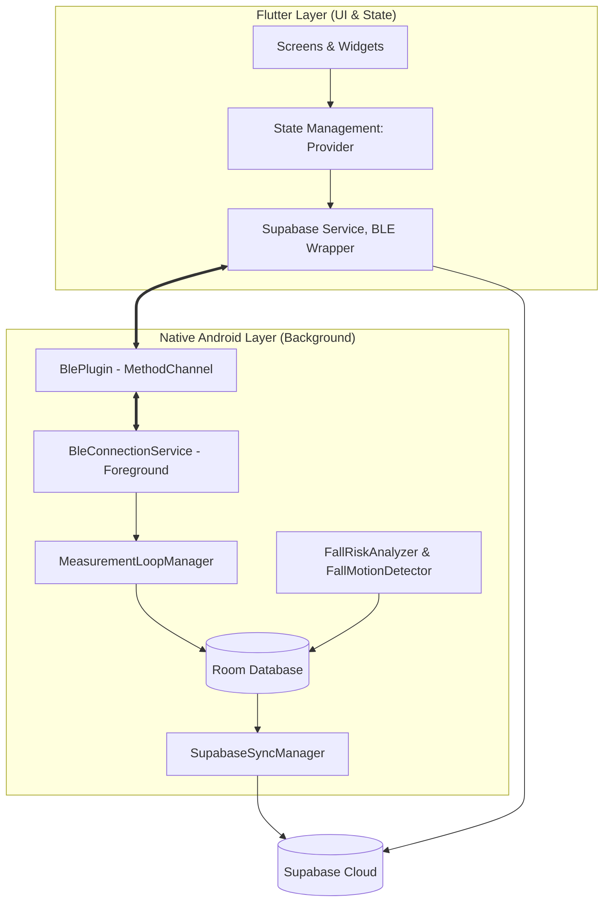

# Project Architecture Overview: The Vital Monitoring (QRing)

The Vital Monitoring app is a hybrid Flutter-Native application designed to interface with the QRing Smart Ring. It provides continuous health monitoring, activity tracking, and emergency response features.

## High-Level Architecture

The project follows a **Hybrid Distributed Architecture** where the UI and user-facing logic are handled by Flutter, while the critical, long-running, and hardware-intensive tasks are offloaded to a native Android background service.

## Technology Stack

### Frontend (Flutter)
- **Language**: Dart
- **State Management**: `provider` for reactive UI updates.
- **Networking**: `supabase_flutter` for cloud data persistence and authentication.
- **Hardware Interop**: `MethodChannel` and `EventChannel` for native Android communication.

### Backend (Native Android)
- **Language**: Kotlin
- **Database**: Room for local data persistence (the "Source of Truth").
- **BLE Management**: Proprietary/SDK-based BLE connection management.
- **Background Processing**: Foreground Service to ensure data collection continues even when the app is minimized or the screen is off.
- **Cloud Sync**: Independent background synchronization logic to Supabase.

### Data & Cloud
- **Database**: Supabase (PostgreSQL)
- **Auth**: Supabase Auth (Email/Password)
- **Real-time**: Leveraged for sync status and remote configuration.

## Key Features
1. **Continuous Vitals Monitoring**: Heart rate, SpO2, Stress, Blood Pressure, and Temperature.
2. **Activity Tracking**: Steps, calories, and distance.
3. **Sleep Analysis**: Detailed sleep stages and scores.
4. **Safety & Emergency**: Advanced fall detection, fall risk prediction, and automated emergency SMS/Calls.
5. **Smart Ring Integration**: Camera control, gesture settings, and firmware updates.
